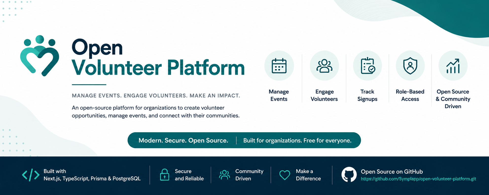

<p align="center">
  
</p>

<h1 align="center">Open Volunteer Platform</h1>

<p align="center">
A modern, open-source volunteer event management platform built with Next.js, TypeScript, Prisma, PostgreSQL, and Tailwind CSS.
</p>

<p align="center">


</p>

## What is Open Volunteer Platform?

An open-source platform for managing volunteer events from start to finish.

I originally built this project for an organization that needed a better way to organize volunteer opportunities, manage event owners, and keep track of registrations. After seeing how well it worked in production, I decided to remove all organization-specific branding and release it as a generic platform that anyone can build on.

Whether you're a nonprofit, school, community group, or company, Open Volunteer Platform gives you a solid foundation for running volunteer programs without starting from scratch.

---

## What it can do

### Public Experience

* Browse upcoming volunteer opportunities
* View event details
* Sign up for events
* View assigned event contacts

### Admin Portal

* Secure administrator login
* Super Admin and Event Admin roles
* Force password change on first login
* Create, edit, archive, and restore events
* Assign event owners
* View volunteer registrations
* Export signup lists
* Manage administrator accounts

### Changes in This Fork

- Fixed volunteer counts on the public event listings.
- Added transaction-based capacity protection to prevent   registrations from exceeding event limits.
- Improved handling of confirmation email failures.

---

## Built With

* Next.js
* React
* TypeScript
* Prisma
* PostgreSQL
* Tailwind CSS

---

## Getting Started

Clone the repository.

```bash
git clone https://github.com/Rihana010/open-volunteer-platform.git
```

Install dependencies.

```bash
npm install
```

Create a `.env` file using the included `.env.example`.

Run the database migrations.

```bash
npx prisma migrate dev
```

Generate the Prisma client.

```bash
npx prisma generate
```

Create the demo administrator accounts.

```bash
npx tsx scripts/create-admin.ts
```

Start the development server.

```bash
npm run dev
```

Open your browser and navigate to:

```
http://localhost:3000
```

---

## Customizing the Platform

This project is designed to be rebranded.

You can easily customize:

* Organization name
* Colors
* Logo
* Departments
* Locations
* Administrator accounts
* Email domain
* Event categories

to fit your own organization.

---

## Screenshots

## Screenshots

Screenshots of the public event listings and admin dashboard will be added here.

---

## Why I Open Sourced This

There are plenty of event management platforms out there, but many are either expensive, overly complicated, or locked behind subscriptions.

My goal was to create something that's clean, modern, easy to understand, and free for anyone to use or improve.

If this project saves you time or helps your organization, that's a win.

---

## Contributing

If you find a bug, have an idea for a feature, or want to improve the project, feel free to open an issue or submit a pull request.

---

## License

Open Volunteer Platform is released under the MIT License.

You're free to use it, modify it, and build on it.

---

## About the Author

I'm **Matthew Ikechukwu Eleweke**, a product designer and full-stack developer who enjoys building practical tools that solve real problems.

If you end up using Open Volunteer Platform, I'd genuinely love to see what you build with it.
